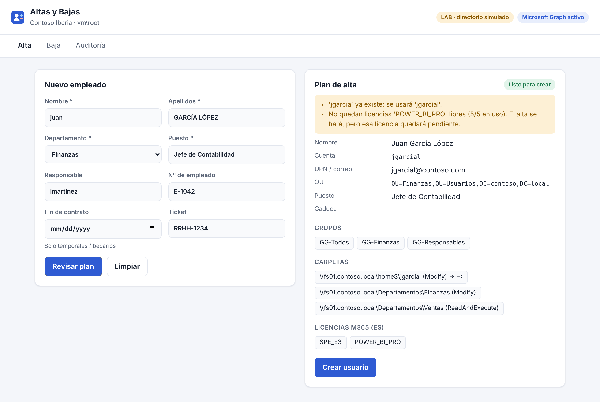
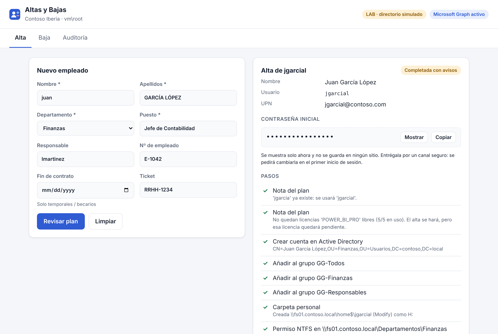
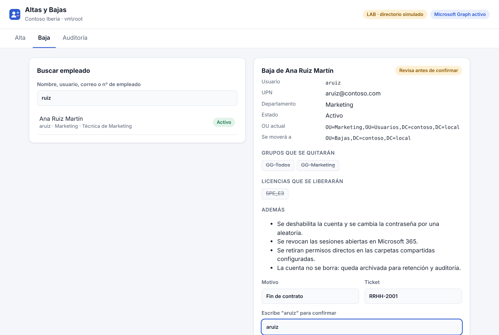
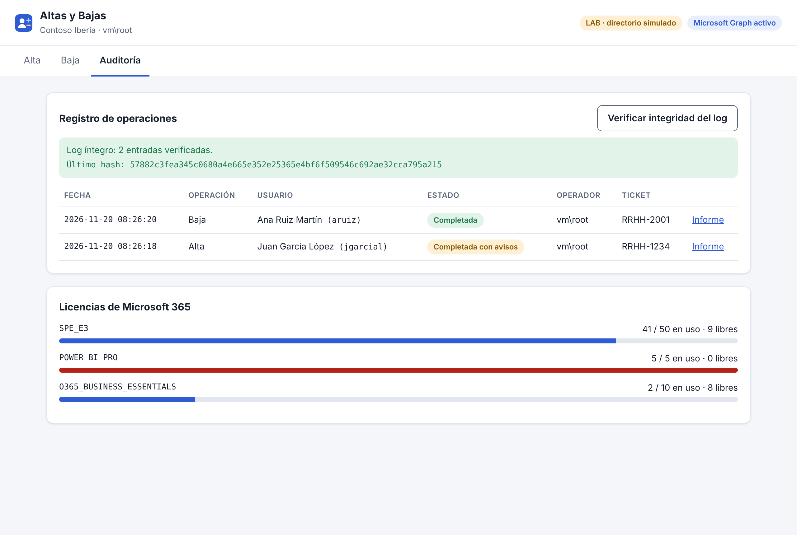
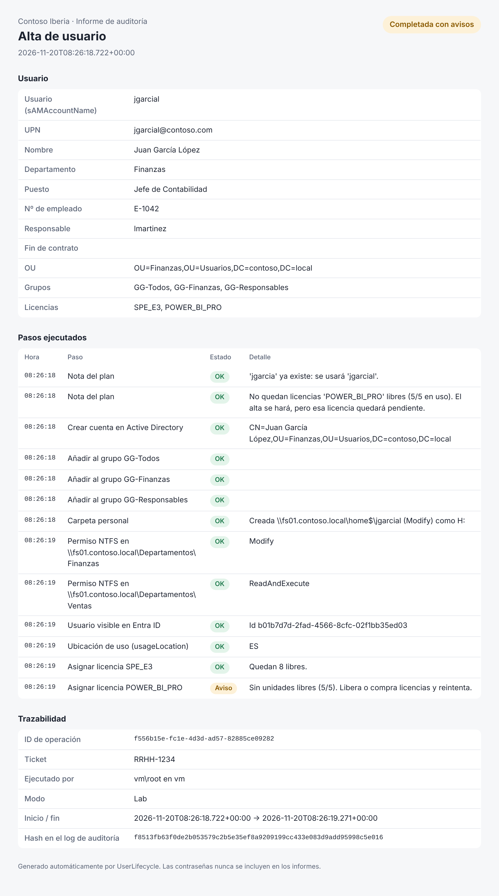
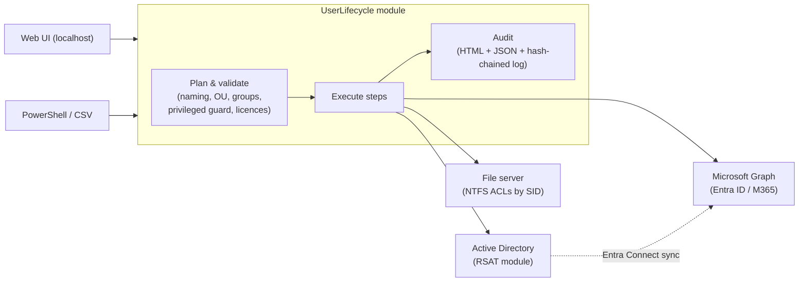

<div align="center">

# Automate-Active-Directory

**Automated employee onboarding & offboarding (joiners / leavers) for Active Directory, file shares and Microsoft 365**

Type a name, a department and a job title → get a correctly placed AD account, the right groups,<br>
folder permissions, Microsoft 365 licences and a tamper-evident audit report. In seconds, the same way every time.




</div>

---

> 📘 **Step-by-step guide (Spanish):** [docs/MANUAL.md](docs/MANUAL.md) — install, try it in Lab mode, build a free Active Directory test lab and connect Microsoft 365.

## Table of contents

- [Why this project](#why-this-project)
- [What it achieves](#what-it-achieves)
- [Features](#features)
- [Screenshots](#screenshots)
- [Quick start (Lab mode, no domain needed)](#quick-start-lab-mode-no-domain-needed)
- [How it works](#how-it-works)
- [Running it against a real domain](#running-it-against-a-real-domain)
- [Configuration](#configuration)
- [Usage](#usage)
- [Security design](#security-design)
- [Audit trail](#audit-trail)
- [Testing](#testing)
- [Project structure](#project-structure)
- [Roadmap](#roadmap)
- [Skills it demonstrates](#skills-it-demonstrates)
- [License](#license)

---

## Why this project

Joiners and leavers are the most repetitive identity task in any IT department, and one of the most error-prone:

| What usually happens | What it costs |
| --- | --- |
| Accounts are created by hand, copying a "similar" colleague | New hires inherit permissions they should never have (privilege creep) |
| Naming is improvised (`jgarcia`, `j.garcia`, `garciaj`…) | Duplicates, broken UPNs and mailboxes, angry users on day one |
| Licences are assigned "when someone remembers" | Day-one productivity lost, or licences paid for people who left months ago |
| Leavers are disabled… sometimes | Orphaned accounts with active cloud sessions are a classic breach vector |
| Nobody can say who did what, and when | Failed audits (ISO 27001, ENS, SOC 2) and painful incident investigations |

A leaver's account that still works, or a new hire who lands in *Domain Admins* because their template was wrong, is not an inconvenience — it's a security incident. This tool turns that process into a **repeatable, validated and audited** workflow.

## What it achieves

- ⏱️ **Minutes → seconds.** A full onboarding (AD account, OU, groups, home folder, share ACLs, usage location, M365 licences, report) is a single action.
- 🎯 **Zero improvisation.** Department and job title determine the OU, groups, folders and licences from one JSON file — the *single source of truth* for access.
- 🛡️ **Least privilege by design.** Privileged groups (detected by SID and `adminCount`, not by name) can never be granted through onboarding.
- 🚪 **Leavers are really out.** Disable, random password reset, Entra ID session revocation, group/ACL/licence removal and archiving — in the right order.
- 🧾 **Audit-ready.** Every operation (including rejected ones) produces an HTML + JSON report and is appended to a hash-chained log that reveals tampering.
- 🧪 **Safe to try.** A built-in **Lab mode** simulates AD and a Microsoft 365 tenant, so you can test, demo or record videos without a domain controller.

## Features

**Onboarding (joiner)**
- Plan-first workflow: everything is resolved and validated *before* anything changes (`-WhatIf` and a "Review plan" step in the UI).
- Smart, collision-free account names that understand Spanish naming: accents and `ñ`, two surnames, particles (`de la Fuente`), hyphens → `jgarcia`, `jgarcial`, `jmgarcia`, `jgarcia2`… (max. 20 chars). Also checks UPN, `mail`, `proxyAddresses` and Entra ID.
- AD account in the department OU, with manager, employee ID, company, description and optional **contract end date** (account expiry, inclusive).
- Groups = base groups + department groups + **job-title rules** with wildcards (`Jefe*` → managers group, `*Becari*` → interns group and a cheaper licence).
- Home folder creation + NTFS permissions on departmental shares, granted **by SID** (works even before AD replication reaches the file server).
- Microsoft 365 via Graph: waits for Entra Connect sync (optionally triggers a delta sync), sets `usageLocation`, checks licence stock and assigns licences. If anything is pending, one call retries just the cloud part.
- Strong initial password from a cryptographic RNG (no ambiguous characters), returned as `SecureString`, shown once, **never logged**.

**Offboarding (leaver)**
- Snapshot of the previous state (groups, OU, licences, description) stored in the report — you can justify or reverse the change.
- Disable account → reset to a random 32-char password → trigger delta sync → **revoke Entra ID sign-in sessions** → remove all groups → purge explicit ACEs on shares → release licences → stamp the description (`BAJA 2026-11-20 | ticket | reason | operator`) → move to the archive OU.
- Refuses to touch built-in accounts (RID 500 / `krbtgt`) or the operator's own account; warns when the leaver had privileged access.
- Idempotent: re-running it on a half-processed leaver is safe.

**Interfaces**
- PowerShell module (pipeline-friendly: `Import-Csv altas.csv | New-LifecycleUser`).
- Hardened local web UI (Spanish), responsive, light/dark.
- Bulk onboarding script for CSV files.

## Screenshots

| Onboarding result (password shown once) | Offboarding with typed confirmation |
| --- | --- |
|  |  |

| Audit log, integrity check and licence stock | Generated audit report |
| --- | --- |
|  |  |

## Quick start (Lab mode, no domain needed)

Requirements: PowerShell 7+ (Windows, Linux or macOS) or Windows PowerShell 5.1.

```powershell
git clone https://github.com/<your-user>/Automate-Active-Directory.git
cd Automate-Active-Directory
./scripts/Start-UI.ps1
```

Open the URL printed in the console (it contains a per-session token). The example configuration runs in **Lab mode**: a fake `contoso.local` directory and tenant are created in `data/lab-directory.json`, with a few existing users so you can see name collisions, a licence that is sold out, and a protected admin account.

Prefer the console?

```powershell
Import-Module ./src/UserLifecycle
Get-LifecycleOnboardingPlan -GivenName 'Juan' -Surname 'García López' -Department Ventas -Title 'Jefe de Ventas'
$r = New-LifecycleUser -GivenName 'Juan' -Surname 'García López' -Department Ventas -Title 'Jefe de Ventas' -Ticket 'HR-1234'
Disable-LifecycleUser -Identity aruiz -Reason 'End of contract' -Ticket 'HR-2001'
Reset-LifecycleLab -IncludeAudit -Confirm:$false   # start over
```

## How it works



1. **Plan.** Input is validated (names, title, IDs, dates) and resolved against the directory: unique account name, OU, groups (rejecting privileged ones), manager, employee ID, folders and licence stock. If there is any blocking error, nothing is created and the attempt is logged as `Rejected`.
2. **Execute.** Each step is recorded as `OK`, `Warning`, `Pending`, `Skipped` or `Failed`. A failing step doesn't hide the others: the operation ends as `Success`, `Partial` or `Failed`.
3. **Audit.** The report and log entry are written last, with the operator, machine, ticket and timestamps.

Every directory, file-share and Graph call goes through a thin backend layer with two implementations — **ActiveDirectory** and **Lab** — so the business logic is identical in both modes and easy to test.

## Running it against a real domain

> ⚠️ Try it first in a test domain or a dedicated OU. Lab mode and the logic are covered by tests; the AD and Graph backends use the standard cmdlets/endpoints but must be validated in your environment.

> The fastest way to get a test domain ready is [`scripts/Initialize-TestDomain.ps1`](scripts/Initialize-TestDomain.ps1): it creates the OUs, groups, shares and sample users your `settings.json` expects (idempotent, supports `-WhatIf`). Full walkthrough in the [manual](docs/MANUAL.md#3-nivel-2--laboratorio-con-active-directory-real).

**1. Prerequisites**
- A Windows machine joined to the domain with RSAT: `Add-WindowsCapability -Online -Name Rsat.ActiveDirectory.DS-LDS.Tools~~~~0.0.1.0`
- An account with delegated rights on the target OUs (create/move/disable users, manage group membership) — don't use a Domain Admin for daily operations.
- NTFS rights to change ACLs on the home root and departmental shares.
- For Microsoft 365: `Install-Module Microsoft.Graph.Authentication -Scope CurrentUser`

**2. Configuration**
```powershell
Copy-Item config/settings.example.json config/settings.json
# edit: "Mode": "ActiveDirectory", domain, OUs, groups, shares, licences
```

**3. Microsoft Graph app registration** (for unattended use)
1. Entra admin center → *App registrations* → *New registration*.
2. *API permissions* → Microsoft Graph → **Application** permissions:
   `User.ReadWrite.All` (usageLocation, session revocation), `LicenseAssignment.ReadWrite.All` (licences), `Organization.Read.All` (licence inventory). Grant admin consent.
3. Upload a certificate (*Certificates & secrets*) and put `TenantId`, `ClientId` and `CertificateThumbprint` in the config with `"Auth": "Certificate"`.
   For interactive testing use `"Auth": "Interactive"` instead (delegated sign-in with the same scopes).
4. Optional: set `Graph.DeltaSyncServer` to your Entra Connect server so the tool runs `Start-ADSyncSyncCycle -PolicyType Delta` instead of waiting up to 30 minutes.

> 💡 If you use **group-based licensing** in Entra ID, leave `Licenses` empty and add the licensing group to the department's `Groups` — the tool will handle it as a regular group membership.

## Configuration

All the access logic lives in [`config/settings.example.json`](config/settings.example.json):

| Key | Purpose |
| --- | --- |
| `Mode` | `Lab` (simulated) or `ActiveDirectory` |
| `Domain` | NetBIOS name, UPN suffix, e-mail domain, optional DC (`Server`), users base OU, **archive OU** |
| `Naming.Pattern` | `FirstInitialLastName` (`jgarcia`) or `FirstDotLast` (`juan.garcia`); `MaxLength` ≤ 20 |
| `Password` | Length (≥ 12) and *change at next logon* |
| `HomeFolder` | Root share, drive letter and NTFS right for personal folders |
| `BaseGroups` | Groups everyone gets |
| `Departments[]` | `Name`, `OU`, `Groups`, `Shares` (`Path` + `Rights`), `Licenses` (SKU part numbers, e.g. `SPE_E3`) |
| `TitleRules[]` | `Match` (wildcards on job title) → extra `Groups`; optional `Licenses` that replace the department's |
| `Offboarding` | Description prefix, revoke share ACEs |
| `Graph` | Enable/disable, auth, `UsageLocation`, sync wait/poll, delta sync server, revoke sessions, remove licences |
| `Audit.Path` / `Lab` | Where reports, the log and the lab database are stored (relative to the config file) |

## Usage

| Command | What it does |
| --- | --- |
| `Get-LifecycleOnboardingPlan` | Dry-run of an onboarding: shows account, OU, groups, folders, licences, warnings, errors |
| `New-LifecycleUser` | Onboarding. Supports `-WhatIf` and pipeline input (Spanish or English CSV headers) |
| `Invoke-LifecycleCloudProvisioning` | Retries only the Microsoft 365 part (sync pending, licences sold out) |
| `Get-LifecycleOffboardingPlan` | Dry-run of an offboarding |
| `Disable-LifecycleUser` | Offboarding. Asks for confirmation by default (`ConfirmImpact = High`) |
| `Find-LifecycleUser` | Search by name, account, e-mail or employee ID |
| `Get-LifecycleAuditLog` / `Test-LifecycleAuditLog` | Read the log / verify its hash chain |
| `Start-LifecycleWebUI` | Local web interface |
| `Reset-LifecycleLab` | Restore the Lab directory |

Bulk onboarding from CSV ([`examples/altas.csv`](examples/altas.csv)):

```powershell
./scripts/Invoke-BulkOnboarding.ps1 -CsvPath ./examples/altas.csv -WhatIf   # preview
./scripts/Invoke-BulkOnboarding.ps1 -CsvPath ./examples/altas.csv
```

## Security design

A tool that creates accounts is a high-value target, so it is built defensively:

| Threat | Mitigation |
| --- | --- |
| Granting admin rights by mistake (or via a tampered config) | Privileged groups blocked by **well-known SID/RID** (language-independent) and `adminCount = 1` |
| Offboarding the wrong account | Built-in accounts and self-offboarding refused; plan preview; typed confirmation in the UI; `ConfirmImpact = High` |
| LDAP injection via search boxes or names | RFC 4515 escaping on every LDAP filter + strict input allow-lists |
| XSS in the UI or reports | Input allow-lists, `textContent`-only DOM rendering, HTML-encoded reports, strict **CSP** |
| CSRF from a malicious website against `localhost` | Per-session 256-bit token + mandatory `X-Lifecycle-Token` header + JSON-only + `Origin` check |
| DNS rebinding | Listener bound to `localhost`, `Host` header allow-list |
| Other users on a shared jump server | Token required to open the UI; exchanged for an `HttpOnly; SameSite=Strict` cookie and removed from the URL |
| Clickjacking, leakage via Referer/cache | `frame-ancestors 'none'`, `X-Frame-Options: DENY`, `Referrer-Policy: no-referrer`, `Cache-Control: no-store` |
| Path traversal on reports | File-name allow-list |
| Password exposure | Crypto RNG, `SecureString`, shown once, never written to logs/reports/disk |
| Log tampering | SHA-256 hash chain (see below) |
| Leaver keeps cloud access after disable | Delta sync + `revokeSignInSessions` + licence removal |

## Audit trail

Each operation writes:

- `data/audit/reports/<timestamp>_<Type>_<user>.html` — human-readable, printable report.
- `data/audit/reports/<timestamp>_<Type>_<user>.json` — machine-readable (feed it to your SIEM).
- One line in `data/audit/audit-log.jsonl` containing `PrevHash` = SHA-256 of the previous line.

`Test-LifecycleAuditLog` walks the chain and reports the first broken line if anything was edited, inserted or deleted. To protect the last entry too, store the returned `LastHash` somewhere external (ticket, SIEM) or forward the log.

## Testing

| Suite | What it covers | Tests |
| --- | --- | --- |
| `tests/Invoke-SmokeTest.ps1` | End-to-end in Lab mode, **zero dependencies** (runs anywhere) | 47 checks |
| `tests/UserLifecycle.Tests.ps1` | Naming, passwords, onboarding, offboarding, audit chain (Lab mode) | 27 |
| `tests/Backends.Tests.ps1` | **Active Directory and Microsoft Graph backends with mocked cmdlets**: exact `New-ADUser` parameters, privileged groups by SID in a Spanish DC (`Admins. del dominio`), `adminCount`, LDAP escaping, inclusive expiry date, Graph endpoints and request bodies, partial failures | 25 |
| `tests/Initialize-TestDomain.Tests.ps1` | The lab-setup script against a **fake, stateful AD** (OU tree order, groups, shares, locked-down NTFS, idempotency, `-WhatIf`) | 7 |
| `tests/WebUI.Tests.ps1` | Starts the **real web server** and attacks it: missing/wrong token, forged `Host` (DNS rebinding), cross-origin POST (CSRF), form posts, oversized and chunked bodies, path traversal, then a full onboarding/offboarding through the API | 19 |

```powershell
./tests/Invoke-SmokeTest.ps1
Invoke-Pester ./tests -Output Detailed
Invoke-ScriptAnalyzer -Path ./src -Recurse -Settings ./PSScriptAnalyzerSettings.psd1
```

**Are the tests any good?** They were checked with *mutation testing*: 11 bugs were injected on purpose (remove the privileged-group block, drop LDAP escaping, disable the CSRF Origin check, remove `SameSite`, leak the password into the report, break the hash chain, skip session revocation…) and **every one of them made at least one test fail**.

GitHub Actions runs everything on **Windows PowerShell 5.1**, **PowerShell 7 on Windows** and **PowerShell 7 on Ubuntu**, plus PSScriptAnalyzer (0 findings with the documented [settings](PSScriptAnalyzerSettings.psd1)).

## Project structure

```
├── config/settings.example.json     # departments, OUs, groups, shares, licences, rules
├── src/UserLifecycle/
│   ├── Public/                      # exported commands (onboarding, offboarding, audit, web UI)
│   ├── Private/                     # naming, config, audit, and the backends:
│   │   ├── Directory.ps1            #   Active Directory | Lab
│   │   ├── FileSystem.ps1           #   NTFS ACLs        | Lab
│   │   ├── Cloud.ps1                #   Microsoft Graph  | Lab
│   │   └── LabStore.ps1             #   simulated directory + tenant
│   └── Web/                         # dependency-free HTML/CSS/JS UI
├── scripts/                         # Start-UI.ps1, Invoke-BulkOnboarding.ps1, Initialize-TestDomain.ps1
├── examples/                        # sample CSVs
├── tests/                           # smoke test + Pester (Lab, mocked AD/Graph, web security)
└── docs/                            # MANUAL.md (Spanish guide) + screenshots
```

## Roadmap

- [ ] **Mover** workflow (department/role change: recalculate groups, folders and licences).
- [ ] Cloud-only mode (create users directly in Entra ID, no on-prem AD).
- [ ] Temporary Access Pass (TAP) instead of an initial password.
- [ ] Exchange Online: convert the leaver's mailbox to shared before removing the licence, auto-reply, manager delegation.
- [ ] Scheduled offboarding (on the last working day) and HR system / ticketing webhooks.
- [ ] Teams/e-mail notifications to the manager.

## Skills it demonstrates

| Area | Where |
| --- | --- |
| Active Directory administration (OUs, groups, AGDLP, account expiry, AdminSDHolder) | `Private/Directory.ps1` |
| Entra ID & Microsoft 365 (AZ-104: users, licences, usage location, hybrid identity sync) | `Private/Cloud.ps1` |
| NTFS permissions & file services | `Private/FileSystem.ps1` |
| Identity governance (JML process, least privilege, evidence for audits) | the whole workflow |
| Secure coding (input validation, injection/XSS/CSRF defences, secrets handling) | `Start-LifecycleWebUI.ps1`, `Naming.ps1` |
| PowerShell engineering (modules, `ShouldProcess`, pipeline binding, PS 5.1/7 compatibility, Pester, CI) | everywhere |

## License

[MIT](LICENSE) — use it, learn from it, adapt it to your company.
